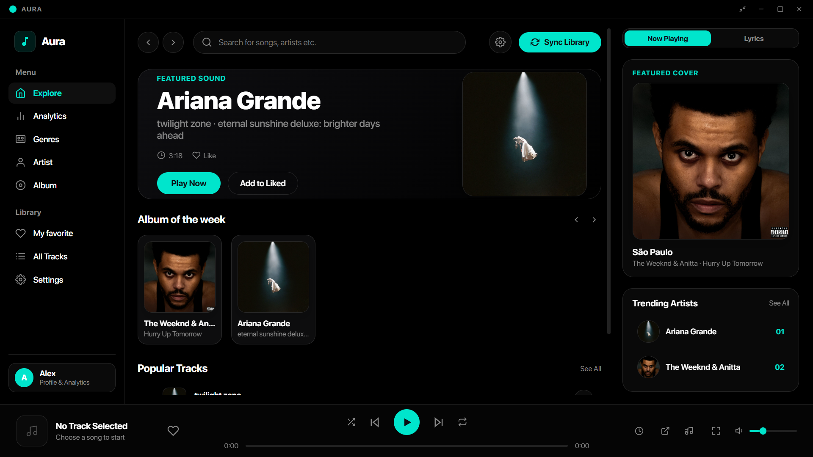
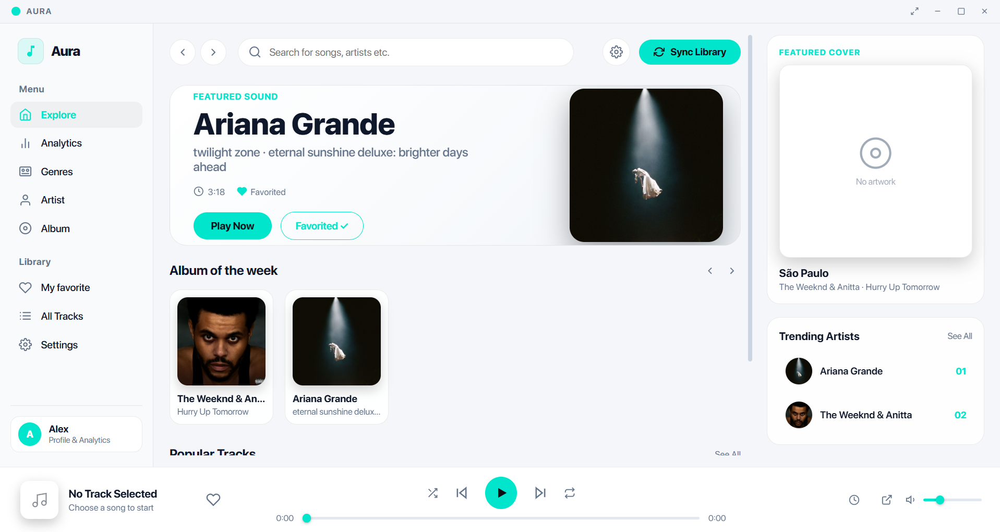
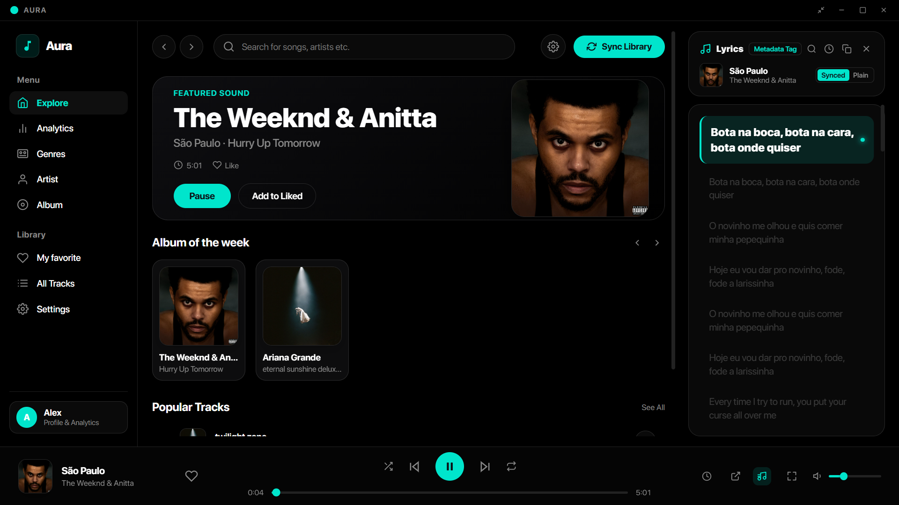
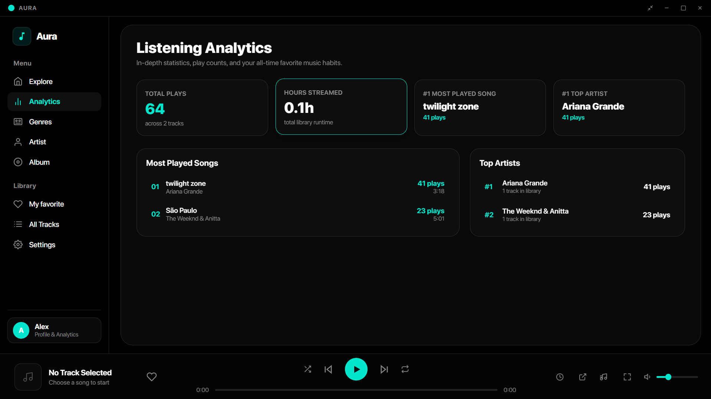
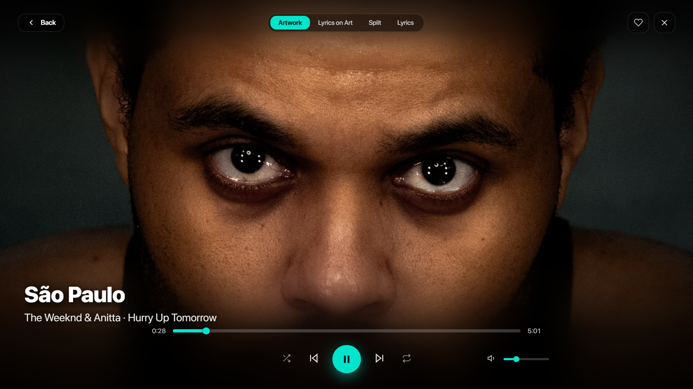
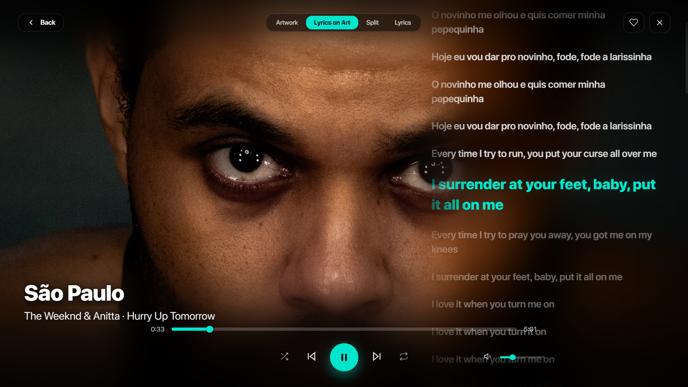
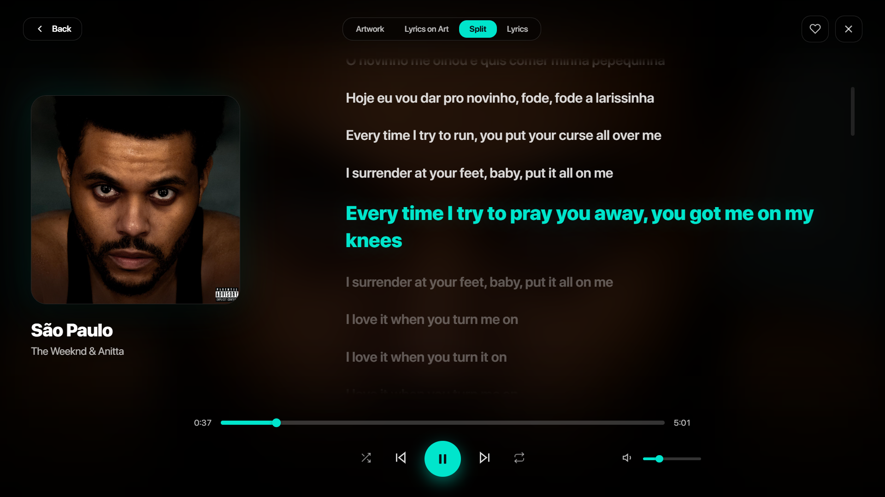
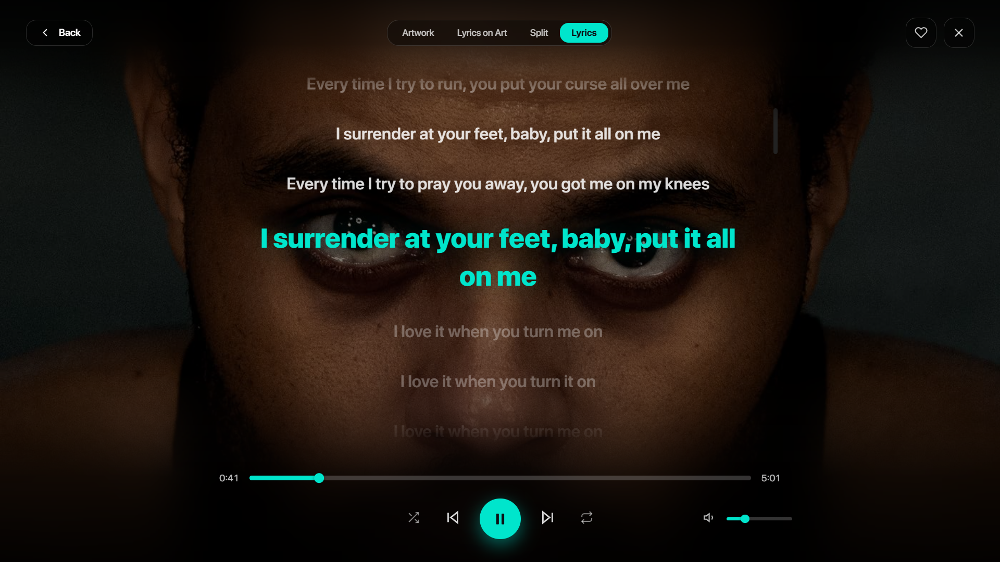

# Aura

Aura is an ultra-fast, modern, desktop music player engineered with **Tauri v2**, **Rust**, **React 19**, and **TypeScript**. Designed with sleek matte glassmorphism, dynamic theming, a non-blocking studio audio engine, and a tiny footprint (~4.8 MB standalone executable / ~1.6 MB installer).

---

## 📸 Screenshots

#### Dark Mode


#### Light Mode Experience


#### Dark Mode with Lyrics Sidebar


#### Genres & Moods View


#### Listening Analytics & Library


---

### Immersive Fullscreen & 4 Lyrics Modes

Aura features a dedicated borderless fullscreen player (**F11** or fullscreen button) with four distinct visual modes:

#### 1. Artwork Mode
Full-screen high-resolution album cover presentation with sleek glassmorphic playback controls.


#### 2. Lyrics on Art Mode
Synchronized lyrics floating seamlessly over subtly darkened and blurred album artwork.


#### 3. Split Mode
Side-by-side layout pairing a high-resolution vinyl-style album art card with auto-scrolling synced lyrics.


#### 4. Fullscreen Lyrics Mode
Clean, distraction-free full-screen synchronized lyrics view with large typography and glowing active lines.


---

## 🌟 What's New in Recent Updates

### 🎨 Modern Frameless Glassmorphic Interface
- **Frameless Title Bar**: Native OS window title bar is cleanly replaced with an integrated, draggable title bar featuring minimalist window controls (**Minimize**, **Maximize/Restore**, and **Close**).
- **Fullscreen Experience**: Seamless toggle into borderless fullscreen mode with **F11** or via the dedicated header control.
- **Dedicated Bottom Player Dock**: Wide, comfortable seekbar scrubber with exact timestamps (`01:23` / `03:45`), high-res artwork, interactive heart favorite button, media controls, and volume slider.
- **Minimalist Explore View**: Home feed is kept clean and clutter-free, displaying purely ranked trending artists and songs (`01`, `02`, `03`...) without distracting play count numbers.

### 🎤 Synchronized Lyrics & Immersive Fullscreen (4 Modes)
- **Automatic Lyrics Retrieval**: Fetches synchronized LRC lyrics and plain text lyrics from LRCLIB and embedded file tags.
- **Dedicated Fullscreen Player (`F11`)**: Four custom layouts:
  - **Artwork Mode**: Full-screen high-res album cover with minimalist floating media controls.
  - **Lyrics on Art Mode**: Smooth animated lyrics floating over tinted and blurred album artwork.
  - **Split Mode**: Side-by-side view featuring high-res album artwork and auto-scrolling lyrics.
  - **Fullscreen Lyrics Mode**: Typography-focused view with active line tracking and glow accents.
- **Interactive Line Seeking**: Click any lyric line to instantly jump to that point in the track.
- **Timing Offset Adjustment**: Fine-tune lyric timing in steps of $\pm 100\text{ms}$ or $\pm 500\text{ms}$, persistently saved per track.
- **In-Lyrics Search & Quick Copy**: Instant keyword search inside lyrics and one-click clipboard copying.
- **Auto-Scroll & Follow**: Smooth auto-centering with a smart 8-second resume timer when manually scrolling.

### 🎧 High-Fidelity Audio Engine & Transitions
- **Non-Blocking Rust Audio Pipeline**: File operations and decoding use `std::io::BufReader` outside mutex locks, completely eliminating UI stutter and audio freezes when switching tracks.
- **Instant Previous & Next Navigation**: Previous track starts immediately on click with queue, shuffle, and repeat edge-case handling.
- **Precision Seeking & Scrubber Interaction**: Native `rodio` random-access seeking with automated decoder fallback; eliminates scrubber jitter and snapback.
- **Intelligent Album Art Engine**: Bounded LRU cache (250 entries), negative caching (`null`), Windows path normalization, and Rust-side image downscaling/compression to prevent memory spikes.
- **Studio Audio Fade-In & Fade-Out**: Smooth volume crossfade transitions when switching tracks, pausing, and resuming playback. Configurable transition speeds in Settings (*Instant*, *Fast 200ms*, *Smooth 350ms*, *Studio 600ms*).
- **Smart Playback Fallback**: Clicking Play or Next without a selected track immediately starts playing your library or resumes your last played song.

### ⏱️ Customizable Sleep Timer (Minutes & Track Count Modes)
- Accessible directly from the bottom player dock and sidebar.
- **Minutes Mode**: Quick presets (**15m**, **30m**, **45m**, **60m**) or custom minutes with live countdown badge.
- **Stop After N Tracks Mode**:
  - Automatically halts playback after completing a chosen number of songs (**1 track / current song**, **2 tracks**, **3 tracks**, **5 tracks**, or custom count).
  - Current song counts as track 1; counter decrements only when songs finish naturally.
  - Manual track skips do not consume counts; repeat-one looping is safely ignored.
- **Studio Audio Fade-Out**: Music smoothly fades out over 1.6 seconds before automatically pausing when the timer expires.

### 📊 Dedicated Listening Analytics Tab
- Dedicated analytics dashboard tracking all listening habits:
  - **Total Plays** and **Hours Streamed** across your entire library.
  - **#1 Most Played Track** and **#1 Top Artist**.
  - **Ranked Most Played Songs** with exact play counts, runtime, and percentage.
  - **Ranked Top Artists Breakdown** showing total plays and library tracks count.

### 🎭 Expanded Browse Tabs (Genres, Artists, Albums)
- **Genres & Moods View**: Dedicated tab featuring visual mood cards (*Hip hop, Pop, Rock, Electronic, Jazz, Classical, Metal, Country, House, Blues*). Clicking any genre lets you explore and play matching tracks.
- **Artists View**: Dedicated view of all artists in your library with avatars and track counts.
- **Albums View**: Grid of discovered album covers with instant playback.
- **Liked Songs (My Favorite)**: Persistent favorite tracks system saved in `localStorage`.

### 🌓 Complete Theme Engine & Custom Accent Chooser
- Cleanly housed inside the **Settings** view:
  - **Base Themes**: **Dark Slate**, **Pure AMOLED Black** (`#000000`), and **Alabaster Light**.
  - **7 Independent Accent Colors**: Choose between **Cyan**, **Neon Purple**, **Emerald Green**, **Rose Pink**, **Electric Blue**, **Sunset Orange**, and **Canary Gold**. Changing accent colors modifies only highlights, buttons, and slider fills without altering your selected base backdrop!
  - **No Distracting Glows**: Eliminated all fuzzy neon glow box-shadows in favor of crisp, modern matte surfaces.

### 👤 User Profile System
- Clickable profile card in the sidebar opening a full Profile Modal:
  - Custom display name and bio/status.
  - Avatar color picker with personal initial badge.
  - Overview of total plays, library size, hours listened, and top artist.

### ⚡ Extreme Size Optimization
- Rust release profile configured with Link-Time Optimization (`lto = true`), size optimization (`opt-level = "z"`), single codegen unit (`codegen-units = 1`), panic abort (`panic = "abort"`), and symbol stripping (`strip = true`).
- **Standalone `.exe` size**: **~4.86 MB**
- **Setup installer size**: **~1.63 MB**

---

## 🛠️ Tech Stack

### Frontend
- **Framework:** React 19 + TypeScript
- **Bundler:** Vite
- **Styling:** Dynamic CSS Variables, Vanilla Glassmorphism (no heavy UI frameworks)
- **Icons:** Lightweight, crisp inline vector SVGs (zero emojis in UI)

### Backend
- **Core Framework:** Tauri v2
- **Language:** Rust (2021 edition)
- **Audio Decoding & Playback:** `rodio` (random-access seeking & seekable builder) + `std::io::BufReader`
- **Metadata Extraction:** `lofty`
- **Artwork Optimization:** `image` (dynamic downscaling & JPEG quality 85 encoding)
- **Filesystem Traversal:** `walkdir`
- **Native OS Dialogs & Shortcuts:** `@tauri-apps/plugin-dialog`, `@tauri-apps/plugin-global-shortcut`

---

## ⌨️ Keyboard Shortcuts

| Shortcut | Action |
| :--- | :--- |
| **`Space`** | Play / Pause |
| **`F11`** | Toggle Fullscreen Mode |
| **`Alt + Shift + Right`** | Next Track |
| **`Alt + Shift + Left`** | Previous Track |
| **`Alt + Shift + Space`** | Play / Pause (Global) |
| **`MediaPlayPause`** | Media key Play / Pause |
| **`MediaNextTrack`** | Media key Next Track |
| **`MediaPreviousTrack`** | Media key Previous Track |

---

## 📦 Getting Started

### Prerequisites
- [Node.js](https://nodejs.org/) (v18+)
- [Rust](https://www.rust-lang.org/tools/install)
- [Tauri Prerequisites](https://tauri.app/v2/guides/getting-started/prerequisites)

### Installation & Development

1. Install dependencies:
   ```bash
   npm install
   ```

2. Run development build (starts Vite frontend + Tauri Rust window with hot reload):
   ```bash
   npm run tauri dev
   ```

3. Fast verification check (verifies TypeScript, Vite bundling, and Rust borrow checker in ~2 seconds):
   ```bash
   npm run build; cargo check --manifest-path src-tauri/Cargo.toml
   ```

4. Build production release executables:
   ```bash
   npm run tauri build
   ```

Generated binaries will be located in:
- Standalone executable: `src-tauri/target/release/aura.exe`
- NSIS Windows Installer: `src-tauri/target/release/bundle/nsis/Aura_0.1.0_x64-setup.exe`
- MSI Package: `src-tauri/target/release/bundle/msi/Aura_0.1.0_x64_en-US.msi`

---

## 📂 Project Structure

```text
Aura/
├── docs/
│   └── screenshots/        # Application screenshots & lyrics modes
├── src/                    # Frontend React code
│   ├── components/
│   │   ├── TitleBar.tsx    # Custom frameless window title bar & controls
│   │   ├── Sidebar.tsx     # Menu, Library navigation, profile & sleep indicator
│   │   ├── MainContent.tsx # Explore hero banner, albums carousel & popular tracks
│   │   ├── PlayerDock.tsx  # Full bottom player bar, wide seekbar & sleep timer
│   │   ├── FullScreenPlayer.tsx # Immersive fullscreen mode (4 layout styles)
│   │   ├── LyricsView.tsx  # Synced/plain lyrics panel with search & offset controls
│   │   ├── Seekbar.tsx     # Precision draggable seekbar scrubber with hold lock
│   │   ├── Artwork.tsx     # Unified album artwork component with matte fallback
│   │   ├── GenresView.tsx  # Dedicated genres & mood cards view
│   │   ├── ArtistsView.tsx # Dedicated artists directory view
│   │   ├── AlbumsView.tsx  # Dedicated albums directory view
│   │   ├── AnalyticsView.tsx # Listening stats & play count breakdown
│   │   ├── ProfileModal.tsx# User profile editor & personal metrics
│   │   ├── Settings.tsx    # Themes, accents, audio fade duration & folder sync
│   │   ├── Library.tsx     # Full library search, sorting & list/grid view
│   │   └── ContextMenu.tsx # Right-click track options
│   ├── App.tsx             # Root orchestrator & audio engine state manager
│   ├── lyricsService.ts    # LRCLIB API client & local lyrics parser
│   ├── types.ts            # TypeScript definitions, base palettes & accent colors
│   ├── utils.ts            # Time formatters & bounded LRU artwork cache
│   └── main.tsx            # Vite DOM renderer
├── src-tauri/              # Backend Rust code
│   ├── src/
│   │   ├── main.rs         # Tauri application setup, IPC handlers & window commands
│   │   ├── audio.rs        # Non-blocking audio playback engine powered by rodio
│   │   ├── scanner.rs      # Metadata & cover art extraction via lofty
│   │   └── tray.rs         # System tray helpers
│   ├── Cargo.toml          # Rust dependencies & binary size release profile
│   └── tauri.conf.json     # Tauri app configuration & window properties
└── package.json            # Node.js dependencies & scripts
```
